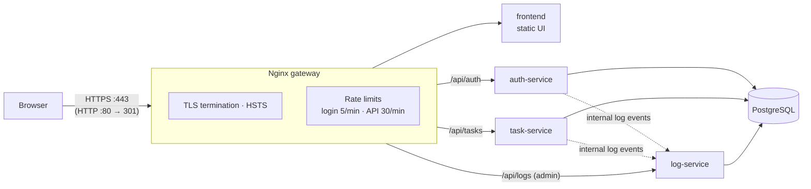

# Task Board — Secure Microservices Behind an HTTPS Gateway

**Three Node.js services (auth, tasks, logs) behind an Nginx gateway that terminates TLS, enforces rate limits and adds security headers, with JWT authentication and an admin-only audit log dashboard.**


> **ENGSE207 Software Architecture, Final Lab Set 1.** Team: Tawan Tiphkun (67543210033-6) and อติโรจน์ กุหลั่น (67543210049-2). The follow-up, [Final Lab Set 2](https://github.com/tawan230666/engse207-final-lab2-67543210033-6-67543210049-2), splits the database per service and deploys to the cloud.

## Architecture



## Security controls

| Layer | Control |
|---|---|
| Transport | HTTPS only: port 80 redirects to 443, TLS 1.2/1.3, HSTS |
| Gateway | `limit_req` throttling (5 req/min on login, 30 req/min on APIs) returning `429` |
| Headers | `X-Frame-Options: DENY`, `X-Content-Type-Options: nosniff`, `X-XSS-Protection` |
| Auth | bcrypt-hashed passwords, JWT with expiry, `401` on missing or invalid tokens |
| Authorisation | Log dashboard and log API restricted to the `admin` role |
| Internal endpoints | `/api/logs/internal` is reachable only inside the Docker network; the gateway returns `403` |
| Data access | Parameterised SQL everywhere; log paging is capped |

## Run it

```bash
git clone https://github.com/tawan230666/final-lab-set1.git
cd final-lab-set1
docker compose up --build
```

Open **https://localhost** and accept the self-signed certificate. One is generated automatically, or create your own first with `./scripts/gen-certs.sh`.

| Account | Password | Role |
|---|---|---|
| `alice@lab.local` | `alice123` | member |
| `bob@lab.local` | `bob456` | member |
| `admin@lab.local` | `adminpass` | admin (log dashboard) |

<p align="center"></p>

## Verified behaviour

Each requirement was tested and captured in [`screenshots/`](screenshots):

| # | Scenario | Evidence |
|---|---|---|
| 1 | All containers running | `01_docker_running.png` |
| 2 | HTTPS served by the gateway | `02_https_browser.png` |
| 3–4 | Login success / failure | `03_login_success.png`, `04_login_fail.png` |
| 5–8 | Task CRUD with JWT | `05`–`08_*.png` |
| 9 | Request without a token → `401` | `09_no_jwt_401.png` |
| 10 | Admin log API | `10_logs_api.png` |
| 11 | Rate limit triggers `429` | `11_rate_limit.png` |

## Project structure

```
nginx/          Gateway: TLS, routing, rate limiting, security headers
auth-service/   Login and JWT issuing
task-service/   Task CRUD (JWT-protected)
log-service/    Central audit log: internal ingest + admin query API
frontend/       Task board and admin log dashboard (static HTML/JS)
db/init.sql     Schema and seed users
scripts/        Self-signed certificate generator
```

## Team split

| Member | Responsibilities |
|---|---|
| **Tawan Tiphkun** | Nginx gateway (HTTPS, proxying, rate limits), frontend task board and log dashboard, Docker Compose and architecture |
| **อติโรจน์ กุหลั่น** | Auth, task and log services, database schema and seed data, JWT authentication |

See [TEAM_SPLIT.md](TEAM_SPLIT.md) and the individual reports for details.
